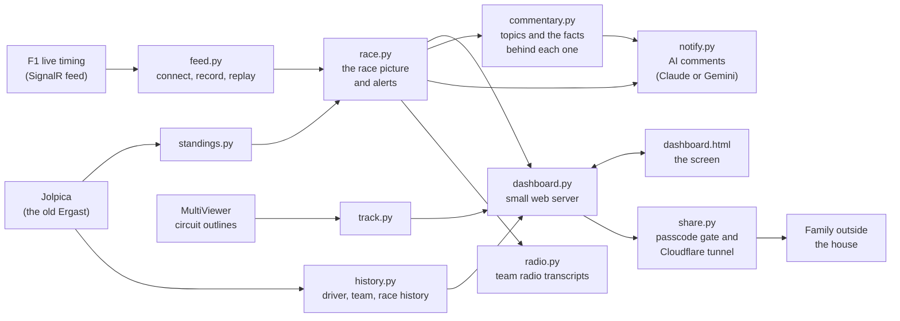

# How it works

This page explains how the dashboard is put together, for anyone who wants to change it or
just wants to know what's going on under the bonnet. To use it, the README is all you need.

## The big picture

The dashboard is a small Python program that runs on a laptop and serves a web page. The
program listens to F1's live timing, works out what's happening and who cares about it,
and the web page asks it for the latest picture every second or so. Anyone in the house can
open the page, and family outside can too, through a private link.



## Where the data comes from

All of it is free.

| What | From | Notes |
|---|---|---|
| Timing, positions, sectors, tyres, flags, race control, team radio, weather at the track | F1 live timing | The same unofficial feed the F1 website and app use. No login. |
| Circuit outlines, corner numbers, marshal sectors | MultiViewer | Downloaded once per track and kept in `tracks/`. |
| Championship standings, driver and team history, past results | Jolpica | The free replacement for Ergast. Saved in `history_cache/`. |
| Rain radar and forecast | RainViewer and Open-Meteo | Loaded by the web page directly; the commentary also checks Open-Meteo's rain chance every ten minutes. |
| Team radio words | faster-whisper | A free speech model that runs on the laptop. Nothing is sent anywhere. |
| Short written comments | Claude or Gemini (optional) | Only if you add a key. Claude is about a tenth of a penny each; Gemini has a free tier in some countries. |

Live car telemetry and GPS are F1 TV only, so car positions on the map are estimated from
when each car last crossed the line and how long its last lap took.

## The pieces

**feed.py** connects to F1's live timing and subscribes to the topics we need. F1 sends a
full picture when you connect, then only the small changes after that. Every message is also
written to the `recordings` folder in F1's own format, so any session can be replayed later
at any speed with `--folder`. Between sessions F1 goes quiet, so the feed checks the
connection every couple of minutes and reconnects if it has dropped.

**race.py** is the heart of it. It folds F1's small changes into one full picture (`merge`),
then works out what has changed since last time: overtakes, pit stops and where a driver will
rejoin, battles, fastest laps, flags, safety cars, retirements, stewards' decisions and
penalties, qualifying drop zones and cut lines, and the finish. Each event is tagged with the
people who follow the drivers involved, which is how the screen colours things and filters
each person's view. It also builds the `view()` the web page draws from. When F1 moves on to
a new session, the timing is cleared and starts afresh while the feed history is kept.

**dashboard.py** starts everything and runs a small web server. The page polls `/state` for
the latest view; other addresses serve the track outline, radio clips, predictions, the AI
buttons and the history windows. It also has the command line options (`--demo`, `--share`,
`--folder` and so on).

**dashboard.html** is the whole screen in one file: the timing tower, the map, the tyre, gap,
speed and standings tabs, the feed, the weather window, predictions, the history windows, the
layout menu and telly mode. It's plain HTML, CSS and JavaScript with no build step. Settings
like the layout or sector times are remembered per screen in the browser.

**history.py** looks things up on Jolpica when you click a driver, a team, the race name or a
past race. Answers are saved on disk and kept until Jolpica has a new qualifying or race
result, so they refresh after each session rather than on a timer. A minute after start-up it
quietly looks up everyone the family follows, one lookup every couple of seconds. Past world
champions are built in rather than looked up. Lookups are spaced out, and if Jolpica ever says
we've asked too much, it backs off for ten minutes and uses what it already has.

**standings.py** gets the championship tables and the calendar from Jolpica every half hour
and works out the points each driver would get if the race finished now.

**notify.py** sends the optional AI comments (Claude, Gemini, or anything OpenAI-style, chosen in config.py) and the "What's happening?" reads. A blank
or failed answer is reported in the feed rather than shown as an empty message.

**commentary.py** turns the timing into the facts for each commentary topic (race so far,
tyres, who's catching who, pit stops and undercuts, a safety car now, the weather and rain
forecast, the cut line, practice pace), works out which
topic is most interesting at the moment, and runs the automatic commentary every five laps or
so. The sums are done here, not by the AI: how fast a gap is closing and when they'd catch, and
where a driver would come out after a stop under a safety car. The AI only writes the words.

**radio.py** fetches team radio clips for your drivers and writes them out with the speech
model, one at a time in the background.

**share.py** handles watching from outside the house. Cloudflare's tunnel makes an outgoing,
encrypted connection, so nothing is opened on the router. Visitors through the tunnel need
the six-digit passcode; people on the home Wi-Fi don't. A correct code sets a signed cookie
that stops working when the dashboard restarts, and five wrong codes from the same place
locks them out for ten minutes.

**predictions.py** runs the podium predictions game and keeps the season scores.

**track.py** downloads circuit outlines from MultiViewer and fits them to the map.

## Settings and secrets

Everything personal lives in `config.py`: who follows which teams and drivers, their colours,
the AI key, and the optional web address for sharing. "1 Set up" makes it by
copying `config.example.py` (or copy it yourself), and it's listed in `.gitignore`, so it never goes to GitHub.

## Tests

The `tests` folder checks the parts that matter most, using the demo recordings and made-up
answers instead of the internet: reading F1's feed, the stewards and penalty handling,
qualifying cut lines, starting a new session, the passcode gate, the history lookups, and
the commentary facts, topic choice and timing, what happens when the AI sends back a blank answer, for Claude, Gemini and OpenAI-style answers. They always use `config.example.py`, so
they give the same result on every computer. GitHub runs them on Windows and Linux every time
code is pushed. To run them yourself:

```
py -m pip install pytest
py -m pytest
```
