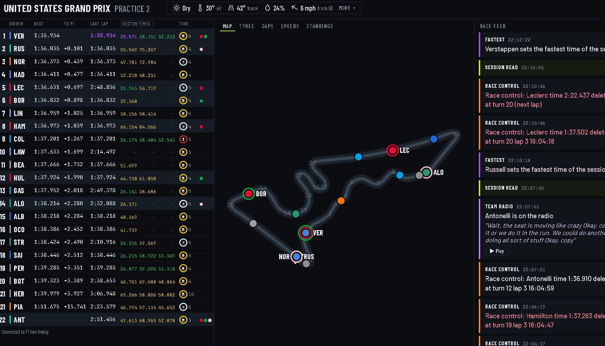

# Ed's Race Weekend Dashboard

[](https://github.com/cs97jjm3/race-weekend-dashboard/actions/workflows/tests.yml)
[](LICENSE)


A live Formula 1 race-weekend screen for the family, running on a laptop and using F1's own
free live timing. Tested live at the 2026 United States Grand Prix in Austin.




The logo is a race circuit with four letters hidden in the track. Can you spot them?

**Try it in your browser: [edsf1.jmmcp.uk](https://edsf1.jmmcp.uk)** (the real dashboard playing a made-up race).

How it's put together: [HOW-IT-WORKS.md](HOW-IT-WORKS.md). This is a home project and isn't
connected to Formula 1 in any way.

## Quick start (no computer skills needed)

1. Double-click **1 Set up**. It installs everything the dashboard needs. If it installs
   Python for you, close the window when it says so and double-click **1 Set up** again.
2. Double-click **Try the demo** to see a made-up race play out in your web browser.
3. On race weekends, double-click **2 Start dashboard** a few minutes before the session.
   Leave the black window open while you watch; close it when you've finished.
4. To let family outside the house watch, double-click **Share with family** instead, and
   send them the link and six-number code it shows.

To make it yours, open **config.py** in Notepad (it appears after the first run) and change
the names, teams and drivers under PEOPLE. Your config.py is private and never shared.

---

A live race screen for the family, using F1's own free live timing: timing tower with sector
times, track map, tyres, gaps, speeds, standings, stewards' decisions, team radio with
transcripts, driver and team history, a predictions game and optional AI commentary. Each
person picks the teams and drivers they follow and gets their own colour and alerts.

## For the technically minded: setting it up by hand

1. Unzip the `race-weekend-dashboard` folder somewhere handy, for example `C:\race-weekend-dashboard`.
2. Open PowerShell in that folder and install the two extras it needs:

   ```
   py -m pip install -r requirements.txt
   ```

3. Phone alerts (optional, free): install the **ntfy** app on each phone, tap "+" and
   subscribe to a topic name. Pick something long and hard to guess, as anyone who knows
   the name can read it, e.g. `james-raceweekend-7f3k9`. Put each name into `config.py`
   next to `ntfy_topic` for James and Ed.

## Trying it out

```
py dashboard.py --demo
```

Your browser opens the dashboard at http://localhost:8080 and a made-up race plays through
in under two minutes, with a pit stop, a safety car, a retirement, a penalty and a lead change,
so you can see the screen and alerts working.

F1 locked its archive of past sessions in mid October 2026 (it now needs an F1 TV login),
so replaying real past races from F1 no longer works. Instead, the dashboard records every
live session to the `recordings` folder as it runs. Replay any of those with:

```
py dashboard.py --folder recordings\2026-10-25_1955 --speed 20
```

Add `--from-lap 30` to jump ahead.

## On race weekends

Start it a few minutes before the session:

```
py dashboard.py
```

It connects to F1's live timing and fills in once the session is running. Each session
is saved in the `recordings` folder so you can replay it later (add `--no-record` to skip that). Leave it going
for the whole session, or the whole weekend: it reconnects by itself if the connection drops,
and when F1 moves on to the next session (FP2 to FP3, say) the timing starts afresh while the
feed keeps its history. Between sessions F1 sends nothing, so the black window says so once
and checks the connection every couple of minutes. Ctrl+C stops it.

Other screens in the house can watch too: open `http://<laptop's IP address>:8080` on
the same Wi-Fi.

## Sharing with someone outside the house

Install Cloudflare's free tunnel program once:

```
winget install --id Cloudflare.cloudflared
```

Close PowerShell and open it again, then start the dashboard with:

```
py dashboard.py --share
```

After a few seconds it prints a link (four random words ending in trycloudflare.com) and a
six-number passcode, and shows both at the top of your screen with a "Send link" button. That
opens a ready-written message you can change, with buttons for WhatsApp, Gmail, Messenger,
other email, a text message or plain copy. Send it as a private message, never a public post. Dad opens the link on his phone, tablet or computer, types the code once, and
he's in. Both change every time you start with --share, so each race gets a fresh pair. To
choose the code yourself: `py dashboard.py --share 271024`.

Nothing is opened on your router: the tunnel makes an outgoing, encrypted connection to
Cloudflare. Anyone at home on your Wi-Fi still gets straight in without a code. Five wrong
codes from the same place locks it out for ten minutes. People watching from outside can't
switch the AI comments off, and they don't see the link or code themselves. Cloudflare says
quick tunnels are meant for testing and come with no uptime guarantee; if the tunnel drops,
the dashboard starts a new one, which means a new link to send.

### Your own web address (optional)

If you have a domain on Cloudflare, the link can be the same every race (for example `race.example.co.uk`) instead of a new trycloudflare.com one. Set it up once in a command window:

```
cloudflared tunnel login
cloudflared tunnel create race-dashboard
cloudflared tunnel route dns race-dashboard race.example.co.uk
```

The first command opens a browser: log in to Cloudflare and pick your domain. Then put the address in config.py:

```
SHARE_HOSTNAME = "race.example.co.uk"
SHARE_TUNNEL = "race-dashboard"
```

From then on `py dashboard.py --share` uses that address. The passcode still changes each time, unless you give one, e.g. `py dashboard.py --share 271024`.

## Qualifying

In qualifying the timing tower shows each driver's best time in the current part, the gap to
P1, and how far they are from the cut. A red dashed line marks the drop zone, the cars below
it are tinted red, and drivers already knocked out are greyed with "out in Q1" or "out in Q2".
With 22 cars, six drop out in Q1 and six more in Q2, then the top ten fight for pole.

Your drivers get alerts when they fall into the drop zone ("Hulkenberg is in the drop zone,
P17, 0.192 off P16"), when they climb out of it, when they're knocked out, and when they make
it through to the next part. Try it with:

```
py dashboard.py --demo quali
```

## Sectors and the middle panel

Every row on the timing tower has three little sector blocks: purple for the fastest anyone
has done, green for a driver's own best, yellow for slower. Click the Sectors heading to swap
the blocks for the actual sector times, in the same colours (click again to go back; it
remembers). On a narrower screen the team names hide to make room. The middle of the screen has tabs:

Map shows the circuit with the cars on it. Tyres shows each driver's stints as coloured bars,
one per set of tyres, so you can see who's still got to stop. Gaps is a line chart of how far
your drivers are behind the car in front, lap by lap, with the "within a second" zone shaded
so you can see who's catching. Speeds ranks everyone by their best speed trap reading.
Standings shows the championship as it would be if the race finished now, with the points
each driver is earning in green, and the team table alongside.

Standings come from the free Jolpica results service. If it can't be reached, the tab just
says so and everything else carries on.

## Stewards and penalties

Every stewards' decision shows in the feed with a white edge and where it's got to: NOTED,
UNDER INVESTIGATION, PENALTY, NO FURTHER ACTION or SERVED, so you can follow an incident to
its outcome. They show for everyone; when your drivers are involved they're tagged to you, and
a penalty for one of yours plays the alert sound. Track limits deletions for your drivers show
as RACE CONTROL.

Penalties also appear as a small white badge by the driver's name in the timing table: +5s,
DT (drive-through), SG (stop-go), a grid penalty, B/W flag or DSQ. Drive-throughs and stop-gos
disappear once served; time penalties stay, as they're added at the finish.

## Driver, team and race history

Click any driver in the timing table for their record: career races, wins, podiums, poles
and titles, this season race by race as a chart, how they've done at this track every year,
and how they stack up against their teammate in races, qualifying and points.

Click the team name next to a driver for the team: this year's championship position, seasons,
wins, podium finishes, poles and titles, both drivers' points, points race by race split
between the two cars, and their best finish at this track each year. (Records count a team
under its current name only, so Alpine doesn't include its Renault or Benetton years.)

Click the race name at the top for the history of the race: every winner here, where they
started, who was on pole, who has won here most and the furthest back anyone has won from.

Click any race in those windows (a bar in a season chart, a year tile, a row of winners) for
that race in full: winner, pole, fastest lap, best climb, retirements, the full result with
places gained or lost, and everyone's Q1, Q2 and Q3 times. ◀ Back returns to where you were.

It all comes from Jolpica (the free replacement for the old Ergast service) and is saved in the
history_cache folder. A minute after the dashboard starts, it quietly looks up everyone the
family follows, one lookup every couple of seconds, so those open straight away; anyone else
takes a few seconds the first time. Results are kept until Jolpica has a new qualifying or race
result, so they refresh after each session rather than on a timer. Past world champions are
built in. Jolpica allows a few hundred lookups an hour; if we ever hit that, anything already
looked up still works and new ones wait about ten minutes.

## Predictions game

Click Predictions at the top before a race or sprint. You and Ed each pick a podium. It locks
at lights out and is scored at the chequered flag: 5 points for each driver in exactly the
right place, 2 if they're on the podium but in a different place, so 15 is a perfect score.
Season totals are saved in predictions.json in the dashboard folder. Replays and the demo can
be played but never count towards the season.

## Race debrief

If the AI comments are on, a few seconds after the chequered flag Claude writes a short debrief
of the race from your and Ed's side, using what happened in the feed and the final order. It
appears at the top of the feed with a Copy button, ready to paste into a message or a post.
After the race, the "What's happening?" button becomes "Race debrief" so you can ask for
another one. It costs well under a penny.

## Telly mode and sound

Telly mode (top right, or press T) makes everything bigger and hides the buttons, for
watching from the sofa. Press Esc or T to leave it.

Sound on makes the dashboard beep for a safety car, a virtual safety car, a red flag and the
chequered flag. Browsers only allow sound after you've clicked something on the page, so
click Sound on at the start of the session.

## The track map

The middle of the screen shows the circuit with every car on it. F1 keeps live GPS for
F1 TV subscribers, so the positions are worked out from timing: when each car last
crossed the line and how long its last lap took. It's right about who's near whom and
how spread out the field is, but a car can be drawn a corner or so out, especially
behind the safety car. Your drivers get a ring in your colour and their name.

Circuit outlines come from MultiViewer's free circuit data (the same source FastF1
uses). Each track is downloaded the first time it's needed and kept in the `tracks`
folder. If one can't be had, the map falls back to a plain loop.

## Flags on the map

When race control puts out a yellow in a marshal sector, that stretch of track lights up
yellow on the map (orange for a double yellow) until it's cleared. The whole circuit turns
amber behind a safety car or VSC, and red for a red flag.

## Team radio

When one of your drivers gets a radio message, it shows in the feed with a Play button.
At Austin in October 2026 the clips came through without an F1 TV login, though F1 could lock
them at any time (the feed then says "Locked, needs F1 TV"). If you've installed the free
speech model, the words appear under the alert:

```
py -m pip install -r requirements-radio.txt
py dashboard.py --test-radio
```

The test transcribes a short public domain clip so you know it works. It runs on the laptop
itself, costs nothing, and downloads the model (about 150 MB) the first time.

## On a phone's home screen

The dashboard can sit on a phone or tablet like an app, with its own icon. Open the link,
then on an iPhone tap Share and "Add to Home Screen"; on Android tap the ⋮ menu and "Add to
Home screen" (or "Install app"). It opens full screen without the browser bars.

## Between sessions

When nothing is live, the middle of the screen switches to a Weekend tab by itself: a countdown
to the next session, the whole weekend's timetable in your own time, the last session's result
with your drivers picked out, and the weather forecast for the start of the next session. A
"Next: Qualifying in 6h 58m" reminder sits next to the race name. Once a session starts it goes
back to the map (or whichever tab you last chose).

## The project website

The `docs` folder is the project's website (edsf1.jmmcp.uk), served free by GitHub Pages. Its
demo is the real dashboard page playing the made-up demo race in the browser. After changing the
dashboard, rebuild it with `py tools\build_web_demo.py` (it needs the Austin track outline in the
tracks folder, which the dashboard saves the first time it runs).

## Hiding and arranging the screen

Use the Show switches (Timings, Map, Feed) to hide any part you don't want, for example
just the map and the feed on the telly. The rest spreads out to fill the space.

Layout ▾, next to them, puts the panels in a different order left to right: move each one
with ◀ and ▶, or "Back to normal". It applies on a wide screen; smaller screens stack the
panels instead. Both are remembered separately on each screen, so the laptop and Dad's
phone can be set up differently.

## Weather

The bar along the top shows dry or rain, air and track temperature, humidity and wind,
straight from F1's timing. Click it to open the weather window: a rain radar map with a
5-mile circle round the circuit (change WEATHER_RADIUS_MILES in config.py) (radar from RainViewer, background map from Esri, playing the last two hours), the
conditions at the track now, and Open-Meteo's forecast for rain at the circuit over the
next three hours in 15-minute steps. Radar detail is coarse that close in, so treat the
forecast as the better guide. Circuit locations are in `config.py` under CIRCUIT_COORDS.

The little light in the top right shows LIVE when data is flowing, QUIET or NO DATA if
it stops, and REPLAY when you're playing something back.

## Changing who you follow

Everything is in `config.py`: the teams and drivers each person follows, the ntfy topics,
how close counts as a battle, and how long a pit stop costs at each track (used to guess
where a driver will rejoin).

## What you get alerted about

Everyone: lights out, safety car, VSC, red flag, back to green, a new race leader, and the
chequered flag with how your drivers finished.

Your own drivers: pit stops with a guess at where they'll rejoin, overtakes, battles within
a second, fastest laps, penalties and investigations, and retirements.

## Good to know

Live car telemetry and GPS are F1 TV only, so the live screen uses timing, gaps, tyres,
pit stops, flags and race control messages, which are all free. Since October 2026 F1's
archive of past sessions needs an F1 TV login too, which is why the dashboard keeps its own
recordings.

This uses unofficial access to F1's timing feed, the same one FastF1 uses. If F1 changes
something, it may need a fix.

## AI comments (optional)

The AI parts can use Claude or Google's Gemini. Pick one in `config.py` with `AI_PROVIDER`
(`"claude"` or `"gemini"`) and put its key next to `ANTHROPIC_API_KEY` or `GEMINI_API_KEY`.
Then check it with:

```
py dashboard.py --test-ai
```

A Claude key comes from console.anthropic.com and costs about a tenth of a penny per comment,
using the small Haiku model. A Gemini key comes from aistudio.google.com/apikey; Google offers a
free tier in some countries (it may not be offered in the UK and Europe, where it can need
billing), and on the free tier Google may use what's sent to improve its products. Anything that
speaks the OpenAI style of request, such as a FreeLLMAPI server on your own laptop, works too
with `AI_PROVIDER = "openai"` and `OPENAI_BASE_URL`.

You can also set a back-up with `AI_FALLBACK`, for example Gemini first and Claude if Gemini is
busy or fails: `AI_PROVIDER = "gemini"` and `AI_FALLBACK = "claude"`, with both keys filled in.
When the back-up answers, the feed says so ("SESSION READ · via Claude"). `--test-ai` checks
both.

With a key, pit stops for your drivers, safety cars, red flags and the finish get a one-line
comment, shown in grey under the alert. Two AI controls appear on the screen. "Comments on/off"
switches the AI comments off (for the screen and the phone alerts) without touching config.py.
"What's happening?" asks for a quick two or three sentence read of the session right now (a
race read, a qualifying read against the cut, or a practice read of times and tyres); there's
a 20 second gap between presses so a double tap doesn't cost twice. If the AI doesn't answer,
the reason shows in the feed and the black window.

### Sharing a comment

AI reads, commentary and the race debrief have a Share button. It opens a window with the text
ready to post, with the family's names taken out first (the AI rewrites it only if a name is in
there; the commentary is told not to use them anyway). Change the wording if you like, tick
"Add a link to the project on GitHub" if you want, then pick X, Facebook, LinkedIn or WhatsApp.
X opens with the post written; Facebook and LinkedIn don't allow that, so the text is copied for
you to paste. People watching through the sharing link don't see the Share button.

### Commentary and asking about a topic

With "Commentary on", the AI adds a couple of sentences to the feed by itself: every 5 laps or
so in a race (never closer than four minutes apart), about every 8 minutes in practice and every
5 in qualifying. It goes quiet under a safety car or red flag, when the feed is busy anyway.
It picks whatever is most interesting at the time rather than at random, and never the same
topic twice running: a gap closing fast, old tyres and who still has to stop, who won and lost
in a round of pit stops, what a safety car now would do, or the race so far. Weather only comes
up when it matters: rain starting, a good chance of rain in the next hour (from Open-Meteo's
forecast for the circuit), or the track temperature changing a lot since the start. These show
as "COMMENTARY · TYRES" and so on.

The ▾ next to "What's happening?" asks about one thing in particular. In a race: Race so far,
Tyres, Who's catching who, Pit stops: who won and lost, Safety car now? and Weather. In
qualifying: Qualifying so far, The cut line and Weather. In practice: Pace so far, Tyres and
long runs, and Weather.

For pit stops, the dashboard notes where each car was when it stopped and who was just ahead,
then compares later: "pitted from P5, now P3, and got past Leclerc, who stopped later" is an
undercut that worked. How long each stop took isn't in the free feed we read, so it can't say
that.

The dashboard works the numbers out itself from the timing (how fast a gap is shrinking and
when they'd catch, where a driver would rejoin after a cheaper stop under a safety car) and the
AI only puts them into words. We know which tyre and how old it is, not wear or temperatures,
so the AI is told never to guess those. A race with commentary uses around a dozen requests.

Keep keys private, like passwords, and never put
config.py on GitHub with a key in it.

## Tests

The `tests` folder checks the important parts with the demo recordings and made-up data, and
GitHub runs them on every push (the green badge at the top). To run them yourself:

```
py -m pip install pytest
py -m pytest
```

## Licence

MIT: use it, change it, share it, as long as the copyright notice stays with it. See LICENSE.
